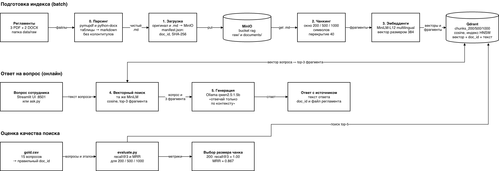

# Отчёт по практической №2

---

## 1. Вариант и задача

| Поле                        | Значение                                                                                                                                                                                                                                                          |
| ------------------------------- | ------------------------------------------------------------------------------------------------------------------------------------------------------------------------------------------------------------------------------------------------------------------------- |
| ФИО (как в VK Education) | Лавров Виктор                                                                                                                                                                                                                                                 |
| Тема                        | 3 - RAG                                                                                                                                                                                                                                                                   |
| Состав решения     | парсинг PDF/DOCX (pymupdf, python-docx) → MinIO + реестр `manifest.json` → чанкинг → эмбеддинги MiniLM → Qdrant (HNSW) → поиск top-3 → Ollama `qwen2.5:1.5b` → Streamlit UI; оценка recall@3 и MRR по `gold.csv` |
| Данные, объем        | 5 регламентов вымышленного химзавода: 3 PDF + 2 DOCX, 97 / 35 / 19 чанков при размере 200 / 500 / 1000; 15 контрольных вопросов                                                                         |

В моём варианте нужно было сделать сервис, который ищет информацию во внутренних документах компании и на её основе отвечает на вопросы сотрудников. Настоящих регламентов у меня не было, поэтому я написал тексты регламентов сам и отдельным скриптом сделал из них PDF и DOCX, как это выглядит в компании: с таблицами, нумерованными пунктами и колонтитулами на каждой странице PDF. Компания вымышленная специально: модель не могла видеть эти цифры при обучении, поэтому разница «без RAG / с RAG» видна честно. Некоторые темы пересекаются между документами: диспетчер 2-01 есть в трёх регламентах, наряд-допуск упоминается в охране труда, пожарной безопасности и в отдельном регламенте, «3 рабочих дня» — и в хранении реагентов, и в командировках. Так поиск сложнее: нужно найти правильный фрагмент, хотя похожая информация есть в других документах.

| doc_id | Документ                                                                  | Формат |
| ------ | --------------------------------------------------------------------------------- | ------------ |
| 1      | Охрана труда и СИЗ                                                 | PDF          |
| 2      | Пожарная безопасность                                         | PDF          |
| 3      | Хранение химических реагентов                          | DOCX         |
| 4      | Наряд-допуск на работы повышенной опасности | PDF          |
| 5      | Отпуска, командировки, компенсации                  | DOCX         |

## 2. Источники и способы сбора

| Источник                   | Тип                                       | Способ сбора                                                                                                                                                                                                                                                                                                                                                                                                                                                                                            |
| ---------------------------------- | -------------------------------------------- | ------------------------------------------------------------------------------------------------------------------------------------------------------------------------------------------------------------------------------------------------------------------------------------------------------------------------------------------------------------------------------------------------------------------------------------------------------------------------------------------------------------------ |
| Регламенты в PDF        | документы PDF, batch                | `convert.py` достаёт текстовый слой через `pymupdf`. Заголовки восстанавливаю по размеру шрифта, таблицы вынимаю отдельно (`find_tables`) и пишу markdown-таблицей, колонтитулы и номера страниц удаляю — иначе они попали бы в каждый чанк. Сканы так не прочитать, для них нужен OCR, его я не делал |
| Инструкции в DOCX       | документы DOCX, batch               | так же, `convert.py` через `python-docx`: обхожу документ по порядку, заголовки → `#`, списки → `-` / `1.`, таблицы → markdown                                                                                                                                                                                                                                                                                                                 |
| Оригиналы и тексты | объектное хранилище, batch | `loader.py` кладёт оригинал в MinIO `raw/`, текст — в `documents/`                                                                                                                                                                                                                                                                                                                                                                                                                     |
| Реестр `manifest.json`     | метаданные, batch                  | пишет `loader.py`: doc_id, название, формат, sha256 оригинала, пути в MinIO, время загрузки. По sha256 видно, изменился ли документ                                                                                                                                                                                                                                                                                                      |
| Вопрос сотрудника  | онлайн-запрос                    | через Streamlit (`app.py`) или `ask.py`. Вопрос превращаю в вектор той же моделью, что и документы, иначе сравнивать их нельзя                                                                                                                                                                                                                                                                                                   |
| Голденсет `gold.csv`    | вручную                               | 15 пар «вопрос → doc_id», по 3 на документ                                                                                                                                                                                                                                                                                                                                                                                                                                                 |

Регламенты меняются редко, поэтому загрузка пакетная, а не поток.

## 3. Архитектура (draw.io)



На схеме три части:

- **Подготовка индекса** (batch): регламенты → парсинг → загрузка в MinIO и реестр → нарезка на чанки → эмбеддинги → Qdrant.
- **Ответ на вопрос** (online): вопрос → эмбеддинг → векторный поиск в Qdrant (3 лучших чанка) → промпт → LLM → ответ с источником.
- **Оценка качества поиска**: `gold.csv` → `evaluate.py` (recall@3, MRR для трёх размеров чанка) → выбор размера чанка.

### Пять стадий RAG

| Стадия          | Что делаю                                                                                                                                                                                                            | Где в коде                                                      | Почему так                                                                                                                                                                                                                                         |
| --------------------- | ---------------------------------------------------------------------------------------------------------------------------------------------------------------------------------------------------------------------------- | ----------------------------------------------------------------------- | ----------------------------------------------------------------------------------------------------------------------------------------------------------------------------------------------------------------------------------------------------------- |
| 1. Ingestion          | PDF/DOCX → чистый `NN-название.md`; оригинал в MinIO `raw/`, текст в `documents/`, запись в реестр                                                                          | `pipeline/00-parsing/convert.py`, `pipeline/01-ingestion/loader.py` | Оригиналы храню в MinIO, чтобы при изменении парсера или нарезки обработать их заново, не обращаясь к источнику                                                     |
| 2. Chunking           | окно 200 / 500 / 1000 символов, перекрытие 40                                                                                                                                                          | `pipeline/02-chunk-embed/chunk_embed.py`                              | Перекрытие нужно, чтобы фраза на границе двух чанков не потерялась. Три размера — чтобы сравнить их по метрикам                                                 |
| 3. Embedding          | `paraphrase-multilingual-MiniLM-L12-v2`, 384d                                                                                                                                                                              | там же                                                             | Модель многоязычная, нормально понимает русский. Вектор, `doc_id` и текст чанка кладу в Qdrant                                                                                           |
| 4. Поиск         | векторный, 3 ближайших чанка по косинусу                                                                                                                                                    | `pipeline/03-rag/retrieve.py`, `common.py`                          | Ищет по смыслу, поэтому находит вопросы, сформулированные своими словами. Минус — плохо находит точные термины, об этом ниже                         |
| 5. Генерация | 3 чанка + вопрос → промпт «Отвечай ТОЛЬКО по контексту, если ответа нет — напиши «В регламентах не найдено»» → Ollama, temperature 0 | `pipeline/03-rag/ask.py`, `app.py`                                  | Чтобы модель отвечала по документам, а не выдумывала. Под ответом показываю `doc_id`, файл и похожесть чанков, чтобы было видно, откуда ответ |

### Векторная БД и выбор индекса

Векторы хранятся в Qdrant, на каждый размер чанка своя коллекция: `chunks_200` , `chunks_500` , `chunks_1000` . Расстояние — косинус. Рядом с вектором в payload лежат `doc_id`, имя файла и текст чанка: по `doc_id` видно, из какого документа ответ, и по нему же считается recall.

Индекс — HNSW (`m=16`, `ef_construct=100`): многоуровневый граф соседей, поиск проверяет только часть векторов, а не все. Точный перебор на сотнях тысяч чанков слишком медленный, а IVF пришлось бы пересоздавать при каждом пополнении базы — HNSW просто дописывается. На моих 97 векторах Qdrant пока ищет перебором (меньше порога `full_scan_threshold`), HNSW включится на большом объёме.

### Зачем гибридный поиск

Результаты на `gold.csv`:

| Размер чанка | Чанков | recall@3     | MRR   |
| ----------------------- | ------------ | ------------ | ----- |
| 200                     | 97           | 15/15 = 1.00 | 0.867 |
| 500                     | 35           | 13/15 = 0.87 | 0.789 |
| 1000                    | 19           | 11/15 = 0.73 | 0.654 |

На каких вопросах поиск промахивается (нужного документа нет в первых трёх):

| Вопрос                                                                                                   | 200 | 500          | 1000         | Почему                                                                                                                                                                                                                                 |
| -------------------------------------------------------------------------------------------------------------- | --- | ------------ | ------------ | -------------------------------------------------------------------------------------------------------------------------------------------------------------------------------------------------------------------------------------------- |
| За сколько дней подаётся заявка на наряд-допуск?                       | —  | промах | —           | нашлись охрана труда (там наряд-допуск только упоминается) и отпуска («подаётся за 14 дней»), а сам регламент о наряде-допуске — нет |
| В какой срок сдаётся авансовый отчёт после командировки?       | —  | промах | промах | «3 рабочих дня» встречаются и в хранении реагентов, поиск путает документы                                                                                                     |
| Чем нельзя тушить натрий и карбид кальция?                                  | —  | —           | промах | в чанке на 1000 символов смешано несколько разделов, вектор получается «про всё сразу»                                                                                  |
| Что делать, если разлилось больше литра реагента?                     | —  | —           | промах | то же самое                                                                                                                                                                                                                         |
| Какое допустимое содержание кислорода при работе в ёмкости? | —  | —           | промах | то же самое                                                                                                                                                                                                                         |

Векторный поиск не цепляется за точные слова. В регламентах их много: «наряд-допуск», номера документов (`РГ-НД-04`), формы (`ХР-7`), марки огнетушителей (`ОП-5`), телефоны (`2-01`). Полнотекстовый поиск (BM25) находит такие запросы по точному совпадению, но не понимает перефразировки. Поэтому нужен гибрид: два поиска, а результаты объединяются через RRF (Reciprocal Rank Fusion). В Qdrant это делается sparse-векторами в той же коллекции. Я его не реализовал, у меня только векторный поиск.

**Размер чанка.** На 200 лучше и recall@3, и MRR. Но при генерации маленький чанк может разрезать пункт: на вопрос про пожар все 3 чанка были из нужного документа, а модель получила обрывок без номера телефона. На 500 на тот же вопрос модель ответила «112». Для поиска лучше 200, для ответа нужен чанк, в который целиком влезает пункт регламента — лучше резать по пунктам и абзацам, а не фиксированным окном.

### Как я оценивал качество поиска

`recall@3` — попал ли нужный документ в первые три чанка, то есть в контекст для LLM. `MRR` — насколько высоко он стоит (1 — первым, 0.5 — вторым). Считал по `gold.csv` для трёх размеров чанка (таблицы выше). Потом задал одни и те же вопросы модели без RAG и с RAG (`compare.py`, чанк 200):

| Вопрос                                                                                          | Без RAG                                                                                                                       | С RAG                                                                                                                                           |
| ----------------------------------------------------------------------------------------------------- | -------------------------------------------------------------------------------------------------------------------------------- | ------------------------------------------------------------------------------------------------------------------------------------------------ |
| Как часто проводится повторный инструктаж для рабочих? | нет — общие слова «после изменения нормативов, при внедрении техники» | да — «один раз в 3 месяца для рабочих профессий»                                                           |
| Куда звонить при пожаре на площадке?                                    | нет — «скорая (102)», советы «удерживайте дыхание»                                         | нет — обрывок «…начальник пожарно-технической службы»                                             |
| Какие реагенты нельзя хранить рядом с кислотами?             | нет — зациклилась на «сульфаты, нитраты»                                                       | частично — «окислители» (надо: щёлочи, окислители, металлы)                                      |
| За сколько дней подаётся заявка на наряд-допуск?              | нет — «за 15 рабочих дней», про транспортные средства                                  | нет — «за 14 календарных дней до начала отпуска», взят чанк из другого документа |
| Сколько дней доп. отпуска за вредные условия труда?         | нет — «конкретный срок не установлен»                                                            | да — «7 календарных дней»                                                                                                    |

### Роль data engineer в подготовке данных для LLM

| Что на мне                                                                                                                        | Что не на мне                                                                                                             |
| ----------------------------------------------------------------------------------------------------------------------------------------- | ----------------------------------------------------------------------------------------------------------------------------------- |
| Собрать документы, хранить оригиналы и вести реестр версий (sha256)                     | Выбрать, дообучить и развернуть LLM, следить за её скоростью и стоимостью |
| Достать текст из PDF и DOCX, сохранить таблицы, убрать колонтитулы                        | Придумать системный промпт и стиль ответа                                                       |
| Нарезать на чанки и подобрать размер по метрикам, а не на глаз                          | Оценивать, насколько хорошо LLM формулирует ответ                                           |
| Посчитать эмбеддинги, загрузить в векторную БД, выбрать и настроить индекс | Решать, кому из сотрудников какие документы можно видеть                            |
| Настроить поиск: векторный, полнотекстовый, гибрид, фильтры                             |                                                                                                                                     |
| Обновлять базу, когда регламенты меняются                                                             |                                                                                                                                     |
| Вести эталон и проверять метрики после каждой переиндексации                         |                                                                                                                                     |

## 4. Docker — что поднялось

| Блок                                                                                                             | Статус                                                                                                                                                                                                                                                      |
| -------------------------------------------------------------------------------------------------------------------- | ----------------------------------------------------------------------------------------------------------------------------------------------------------------------------------------------------------------------------------------------------------------- |
| MinIO (Silo), API :9000 и веб-консоль :9001                                                               | поднялся, консоль открывается                                                                                                                                                                                                           |
| Qdrant :6333 и dashboard `/dashboard`                                                                             | поднялся, dashboard открывается                                                                                                                                                                                                                |
| Ollama :11434                                                                                                        | поднялся, отвечает «Ollama is running»                                                                                                                                                                                                          |
| python + Streamlit :8501                                                                                             | поднялся                                                                                                                                                                                                                                                  |
| `loader.py` → bucket `rag`, папка `documents/`                                                           | реализовано, 5 файлов `.md`                                                                                                                                                                                                                    |
| `manifest.json`: doc_id, title, path, loaded_at                                                                    | реализовано, 5 записей                                                                                                                                                                                                                          |
| Модель MiniLM (384) скачана в кэш `hf-cache`                                                      | реализовано                                                                                                                                                                                                                                            |
| Коллекции `chunks_200` / `chunks_500` / `chunks_1000`                                                 | реализовано, 97 / 35 / 19 чанков (больше размер → меньше чанков)                                                                                                                                                        |
| В payload чанка `doc_id`, `chunk_text`, `num_chars`                                                      | реализовано                                                                                                                                                                                                                                            |
| Модели Ollama `qwen2.5:0.5b` / `1.5b` / `3b`                                                             | скачана только `qwen2.5:1.5b` (подходит для 8 ГБ памяти); 0.5b и 3b не качал                                                                                                                |
| `retrieve.py` — поиск top-k чанков                                                                     | реализовано                                                                                                                                                                                                                                            |
| `ask.py` — ответ с RAG и без RAG                                                                        | реализовано, ответы разные: с RAG по документам                                                                                                                                                                               |
| `evaluate.py` — recall@3 и MRR для трёх коллекций                                                | реализовано                                                                                                                                                                                                                                            |
| Streamlit UI: вопрос → ответ + найденные чанки                                             | реализовано, проверил: «Какие суточные в командировке по России?» → «1 200 рублей в сутки», источник doc 5. Выбор модели в UI убрал, всегда `qwen2.5:1.5b` |
| Парсинг PDF и DOCX в `.md` (`convert.py`) | реализовано, 3 PDF + 2 DOCX                                                                                                                                                                                                                            |
| Оригиналы PDF/DOCX в MinIO `raw/`, в реестре формат и sha256                              | реализовано                                                                                                                                                                                                                                            |
| `compare.py` — сравнение без RAG / с RAG на нескольких вопросах                  | реализовано, 5 вопросов                                                                                                                                                                                                                        |

`docker ps`:

```
NAMES       IMAGE                  STATUS          PORTS
p2-py       python:3.12-slim       Up 21 minutes   0.0.0.0:8501->8501/tcp, [::]:8501->8501/tcp
p2-qdrant   qdrant/qdrant:latest   Up 21 minutes   0.0.0.0:6333->6333/tcp, [::]:6333->6333/tcp
p2-minio    pgsty/silo:latest      Up 21 minutes   0.0.0.0:9000-9001->9000-9001/tcp, [::]:9000-9001->9000-9001/tcp
p2-ollama   ollama/ollama:latest   Up 21 minutes   0.0.0.0:11434->11434/tcp, [::]:11434->11434/tcp
```

Как запускал (по шагам):

```bash
docker compose up -d                                           # 4 контейнера
docker compose exec py pip install torch --index-url https://download.pytorch.org/whl/cpu
docker compose exec py pip install -r /app/requirements.txt    # библиотеки, один раз
docker compose exec ollama ollama pull qwen2.5:1.5b            # модель ~1 ГБ, один раз

# 0. PDF/DOCX -> md
docker compose exec py python /app/pipeline/00-parsing/convert.py
#    [parse] готово: 5 документов

# 1. загрузка в MinIO + manifest.json
docker compose exec py python /app/pipeline/01-ingestion/loader.py
#    [load] doc_id=1 01-охрана-труда-и-сиз.pdf -> raw/, 01-охрана-труда-и-сиз.md -> documents/ ...
#    [load] готово: 5 документов, реестр manifest.json

# 2-3. чанки + эмбеддинги в Qdrant (три размера чанка)
docker compose exec py python /app/pipeline/02-chunk-embed/chunk_embed.py --chunk-size 200
docker compose exec py python /app/pipeline/02-chunk-embed/chunk_embed.py --chunk-size 500
docker compose exec py python /app/pipeline/02-chunk-embed/chunk_embed.py --chunk-size 1000
#    [chunk] итого 97 чанков -> Qdrant 'chunks_200' (cosine, HNSW m=16)
#    [chunk] итого 35 чанков -> Qdrant 'chunks_500' (cosine, HNSW m=16)
#    [chunk] итого 19 чанков -> Qdrant 'chunks_1000' (cosine, HNSW m=16)

# оценка поиска
docker compose exec py python /app/pipeline/03-rag/evaluate.py --chunk-size 200 500 1000
#    chunk_size=200: recall@3 = 15/15 = 1.00, MRR = 0.867

# 4-5. ответ без RAG и с RAG
docker compose exec py python /app/pipeline/03-rag/ask.py --no-rag "Сколько дней дополнительного отпуска за вредные условия труда?"
docker compose exec py python /app/pipeline/03-rag/ask.py --chunk-size 200 "Сколько дней дополнительного отпуска за вредные условия труда?"
#    === С RAG (qwen2.5:1.5b, chunks_200) ===
#    7 календарных дней.
docker compose exec py python /app/pipeline/03-rag/compare.py --chunk-size 200 --n 5

# интерфейс
docker compose exec py streamlit run /app/pipeline/03-rag/app.py --server.address 0.0.0.0 --server.port 8501
```

Что не получилось сразу:
- `pip install` очень долго качал torch с CUDA-библиотеками на несколько ГБ, хотя видеокарты нет — поставил CPU-сборку torch отдельной командой.
- Модель без RAG на одном вопросе зациклилась и генерировала больше 10 минут, запрос упал по таймауту — ограничил длину ответа `num_predict=300`.

## 5. Описание пути данных

| Шаг                                                                                                           | Для чего                                                                                                                                               | Результат                                                                                            |
| ---------------------------------------------------------------------------------------------------------------- | ------------------------------------------------------------------------------------------------------------------------------------------------------------- | ------------------------------------------------------------------------------------------------------------- |
| 1. Регламент (PDF/DOCX) лежит в `data/raw/`                                                     | это источник, в компании это была бы общая папка или система документооборота                | `NN-название.pdf` / `.docx`, где `NN` = doc_id                                               |
| 2. `convert.py` достаёт текст                                                                      | модели нужен текст, а не PDF; таблицы и заголовки сохраняю, колонтитулы удаляю                   | `data/md/NN-название.md`                                                                            |
| 3. `loader.py` кладёт оригинал и текст в MinIO                                            | хранить исходник, чтобы можно было переобработать                                                                  | `s3://rag/raw/NN-название.pdf`, `s3://rag/documents/NN-название.md`                       |
| 4. Запись в `manifest.json`                                                                             | список того, что загружено, и версия документа                                                                          | 5 записей: doc_id, название, формат, sha256, пути, время                        |
| 5. `chunk_embed.py` режет текст на чанки (200 / 500 / 1000, перекрытие 40)          | весь документ в контекст не влезет, а вектор целого документа получится слишком общим | 97 / 35 / 19 чанков                                                                                     |
| 6. Каждый чанк → вектор MiniLM                                                                  | для поиска по смыслу                                                                                                                         | вектор из 384 чисел                                                                              |
| 7. Векторы + `doc_id` + текст → Qdrant                                                            | быстрый поиск ближайших (HNSW)                                                                                                           | коллекции `chunks_200/500/1000`                                                                    |
| 8. Вопрос сотрудника → вектор той же моделью                                  | чтобы вопрос и документы можно было сравнивать                                                                        | вектор вопроса                                                                                   |
| 9. Qdrant возвращает 3 ближайших чанка                                                   | найти нужные куски регламентов                                                                                                     | 3 чанка с `doc_id` и похожестью                                                            |
| 10. Промпт «Отвечай ТОЛЬКО по контексту» + чанки → Ollama `qwen2.5:1.5b` | чтобы модель отвечала по документам, а не выдумывала                                                              | «7 календарных дней» + источник `05-отпуска-и-командировки.md` |
| 11. `evaluate.py` по `gold.csv`                                                                            | проверить, что поиск находит нужные документы                                                                          | recall@3 1.00 / 0.87 / 0.73, MRR 0.867 / 0.789 / 0.654                                                        |

## 6. Выводы

1. RAG со своей задачей справился частично: с контекстом модель ответила верно на 2 вопроса из 5 и на 1 частично, без контекста — ни на один. Без RAG ответы были не просто неточные: модель выдумывала, назвала неверный телефон при пожаре и зациклилась на одном вопросе.
2. Модель у меня маленькая, всего 1.5B, но с правильным контекстом отвечает точно («7 календарных дней», «раз в 3 месяца»). Обе ошибки с RAG случились из-за поиска и нарезки: в одном случае в контекст попал обрывок пункта, в другом — чанк из чужого документа. Значит, главное здесь — подготовка данных и поиск, а это как раз работа data engineer.
3. Одного векторного поиска мало. Он путает документы с похожими словами («заявка за сколько дней» — отпуск или наряд-допуск) и не цепляется за точные термины и коды, а в регламентах их много. Нужен гибрид: вектор + полнотекст через RRF.
4. Размер чанка надо подбирать по метрикам. У меня 200 дал лучший recall и MRR, а большой чанк смешивает разделы, и поиск ошибается. Но маленький чанк может разрезать пункт, и в LLM уходит обрывок. Лучше нарезать по структуре документа — по пунктам и абзацам.
5. Индекс нужен, когда векторов много: на моих 97 векторах Qdrant всё равно ищет перебором. Для постоянно пополняемой базы регламентов удобнее HNSW, его не нужно пересоздавать.
6. Что не успел и что бы добавил: гибридный поиск, нарезку по пунктам, OCR для сканов, автоматическую переиндексацию по изменению sha256, фильтр по правам доступа (не всем сотрудникам можно видеть все регламенты) и эталон побольше — на 15 вопросах разница в 1–2 вопроса между размерами чанка может быть случайной.

### Мой любимый десерт

брауни
